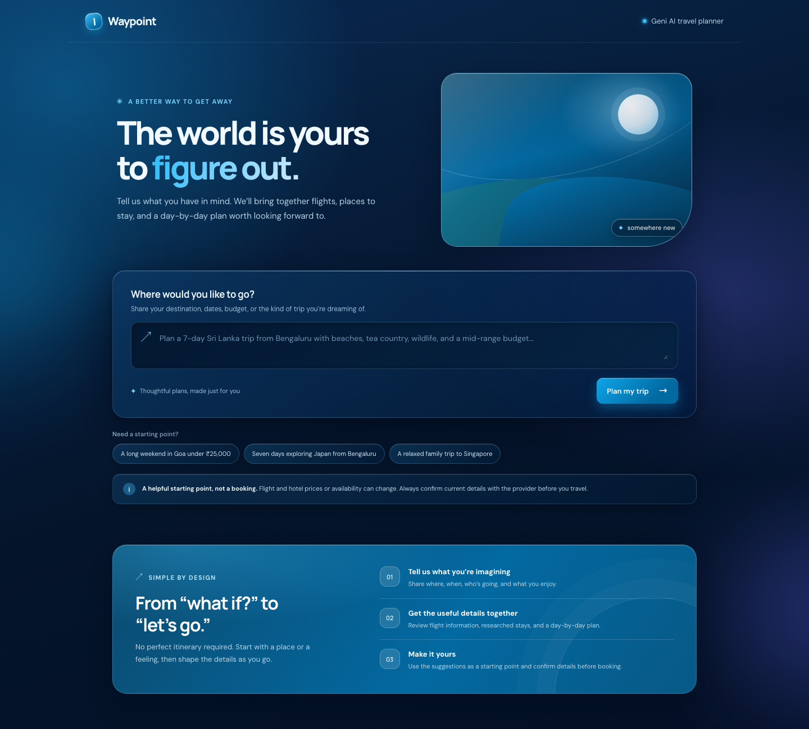

# Waypoint

Waypoint is a small AI-assisted trip planner. Describe a trip in the web page
to receive a travel overview, flight information when available, hotel research,
and a day-by-day itinerary.

## Requirements

- Python 3.9 or later
- API keys for Groq and Tavily to generate travel plans
- An AviationStack API key for live flight status results (optional)

Flight status data is not ticket pricing. Hotel results and generated plans are
suggestions; confirm current availability, prices, and travel requirements with
the provider before booking.

## Setup

From the project directory, create and activate a virtual environment:

```bash
python3 -m venv .venv
source .venv/bin/activate
python -m pip install --upgrade pip
pip install -e .
```

On Windows PowerShell, activate it with:

```powershell
.\.venv\Scripts\Activate.ps1
```

The editable install reads runtime dependencies from `requirements.txt` and
installs the application modules, tools, and static assets from the project root.

Create a local environment file and add your API keys:

```bash
cp .env.example .env
```

Set `GROQ_API_KEY` and `TRAVILY_API_KEY` in `.env`. Set
`AVIATIONSTACK_API_KEY` if live flight status is desired. `.env` is ignored by
Git; do not commit real API keys.

## Project structure

```text
.
├── pyproject.toml          # Installable package configuration
├── app.py                  # FastAPI routes and request validation
├── service.py              # LangGraph travel-planning workflow
├── tools/
│   ├── flight_tool.py      # AviationStack search and airport resolution
│   └── tavily_tool.py      # Hotel and destination web research
├── static/                 # Responsive planner page and browser assets
├── tests/                  # Unit and API tests (external calls are mocked)
├── .env.example            # Environment variable template
├── Dockerfile              # Container image definition
├── .dockerignore           # Excludes local secrets and development files
└── requirements.txt
```

## Run the application

With the virtual environment active:

```bash
uvicorn app:app --reload
```

Open [http://127.0.0.1:8000](http://127.0.0.1:8000) in a browser. The interactive
API documentation is available at [http://127.0.0.1:8000/docs](http://127.0.0.1:8000/docs).

The planner endpoint accepts a JSON request:

```bash
curl -X POST http://127.0.0.1:8000/api/ask \
  -H "Content-Type: application/json" \
  -d '{"question":"Plan a 5-day Sri Lanka trip from Bengaluru"}'
```

## Run with Docker

Build the image from the project directory:

```bash
docker build -t waypoint-travel-planner .
```

Run the container with your local environment file. The application listens on
port `8000` inside the container and is available at
[http://localhost:8000](http://localhost:8000):

```bash
docker run --rm --name waypoint-travel-planner \
  --env-file .env \
  -p 8000:8000 \
  waypoint-travel-planner
```

The `.dockerignore` file prevents `.env`, the local virtual environment, test
files, and development assets from being copied into the image. Pass secrets at
runtime with `--env-file`; do not add API keys to the Dockerfile or image.

## Run tests

Tests use Python's built-in `unittest` runner and mock external API calls, so
they do not require working API keys or make network requests:

```bash
python -m unittest discover -s tests -v
```

The suite covers route and airport resolution, flight-result formatting and
error handling, Tavily result formatting, request validation, and the web/API
routes.

## Live deployment

The application is deployed on Vercel: [https://travel-agent-phi-inky.vercel.app/](https://travel-agent-phi-inky.vercel.app/)


